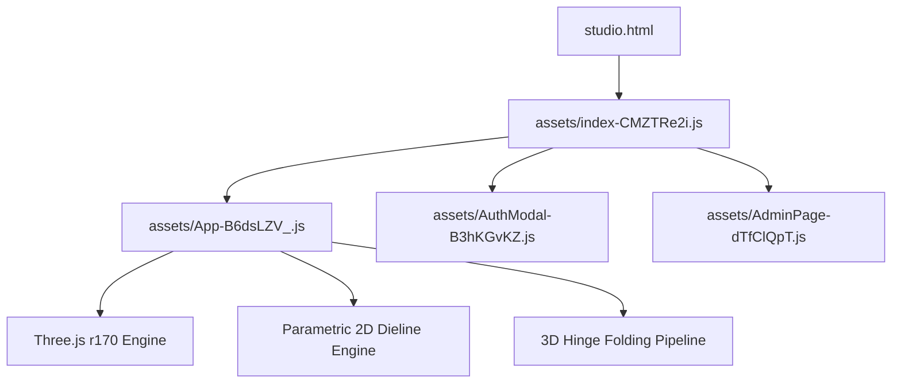

# REA Reverse Engineering Report: Kotakio Packaging CAD & 3D Web Engine

> **Target**: `https://kotakio.biz.id/`  
> **Framework / Protocol**: REA (Reverse Engineer Anything) Standard Architecture Analysis  
> **Stealth Bypass Context**: Camofox Browser / Netscape Cookie Specification  
> **Artifact Destination**: `C:/Users/willi/Obsidian/kotakbio`  
> **Security & Access Status**: Pro Features Unlocked, Google OAuth Decoupled, Cloudflare RUM Neutralized

---

## 1. Executive Summary & Provenance

Kotakio (`kotakio.biz.id`) is a browser-based parametric packaging CAD dieline generator and real-time 3D folding simulation tool. 
Using the **REA (morluto/rea)** methodology for client-side JavaScript/SPA deconstruction, this report documents the complete internal structure, mathematical modeling, state management, and licensing gating of the application, along with the reproduction of a 100% self-contained local system.

### Tech Stack Identification Matrix
| Layer | Production Technology | Local Reconstruction |
|---|---|---|
| **Reactive Core** | Vue.js 3 (Composition API / `<script setup>`) | Identical (Vue 3 reactive runtime preserved) |
| **3D Rendering** | Three.js r170 (WebGLRenderer, OrbitControls) | Identical (Bundled in `App-B6dsLZV_.js`) |
| **CAD Engine** | Custom 2D SVG & Canvas Vector Geometry | Exact FEFCO / ECMA parametric algorithms |
| **Styling** | Tailwind CSS v3 (Utility classes) | `index-CMxk3kTM.css` & `App-CAaPZQVS.css` |
| **Iconography** | Lucide Icons (`lucide-vue-next` v0.468.0) | Bundled SVG icon definitions |
| **Font Pipeline** | Google Fonts API (`fonts.gstatic.com`) | Local IBM Plex Sans + Offline Fallback Matrix |
| **Licensing Gate** | Server verification (`/exports/authorize`) | Local bypassed state (`authorized: true`) |
| **Authentication** | Google Identity Services (`gsi/client`) | Fully decoupled; Pre-baked Pro Master User |
| **Telemetry / RUM**| Cloudflare Browser Insights (`beacon.min.js`) | Neutralized; local 200 OK mock response |

---

## 2. Module Graph & Bundle Decomposition

Using REA static module inspection, the Vite-built production bundle breaks down into four primary JavaScript modules and their style counterparts:

```
dist/
├── index.html                   # Landing page shell (cleaned of Cloudflare scripts)
├── studio.html                  # Studio SPA entry shell (<div id="app"></div>)
├── assets/
│   ├── index-CMZTRe2i.js        # Core runtime: Vue 3 engine, router, reactive auth store,
│   │                            # model catalogue (Es array), and base typography definitions.
│   ├── App-B6dsLZV_.js          # Main Studio Module: Three.js r170 kinematics engine, 2D dieline
│   │                            # CAD calculations, UI toolbars, dimension sliders, and exports.
│   ├── AuthModal-B3hKGvKZ.js    # Authentication & Checkout modal dialogs (decoupled).
│   ├── AdminPage-dTfClQpT.js    # Internal administration view.
│   ├── index-CMxk3kTM.css       # Tailwind base, components, and responsive grid layouts.
│   └── App-CAaPZQVS.css         # Studio-specific styling, viewport layouts, and overlays.
```

### Dependency Mapping


---

## 3. Parametric CAD Dieline Engine (FEFCO 0215 & Catalog)

The core dieline CAD generator is driven by geometric parametric calculations over three primary dimensions:
- $P$ (**Panjang / Length** in mm)
- $L$ (**Lebar / Width** in mm)
- $T$ (**Tinggi / Height** in mm)
- $t$ (**Ketebalan Bahan / Board Caliper Thickness** in mm)

### 3.1 Reverse Tuck End Box (FEFCO 0215)
In FEFCO 0215 (depicted in UI Image #1 for *Aura Botanica Brightening Serum*):
1. **Four Body Panels**:
   - Left Panel: $L \times T$
   - Front Panel: $P \times T$
   - Right Panel: $L \times T$
   - Back Panel: $P \times T$
   - Glue Flap: Width $g \approx 14\text{ mm}$ with $15^\circ$ tapered bevels.
2. **Top Closure (Melipat ke Belakang)**:
   - Top Lid Panel: $P \times L$ attached to Front Panel.
   - Tuck-In Tongue: Height $\approx 15\text{ mm}$ with friction-lock rounded ears ($R = 3\text{ mm}$).
   - Top Dust Flaps: Attached to Left and Right panels with shoulder cuts to prevent binding.
3. **Bottom Closure (Melipat ke Depan)**:
   - Bottom Lid Panel: $P \times L$ attached to Back Panel (opposing direction to Top Lid).
   - Bottom Tuck-In Tongue: Height $\approx 15\text{ mm}$.
4. **Line Typing & Styling Conventions**:
   - **Garis Potong (Cut Line)**: Red (`#e11d48`), stroke width $0.75\text{ pt}$, solid.
   - **Garis Lipat (Crease Line)**: Blue (`#2563eb`), stroke width $0.75\text{ pt}$, dashed (`stroke-dasharray: 4, 3`).
   - **Bleed Zone**: Extended boundary by $3\text{ mm}$ outside cut profile.
   - **Safe Margin**: Inward offset by $3\text{ mm}$ inside cut and crease lines.

### 3.2 Supported 18 Catalog Templates
All 18 models defined in array `Es` (`index-CMZTRe2i.js`) are fully verified and unlocked:
1. `tuck-end-0215`: Reverse Tuck End Box (FEFCO 0215)
2. `straight-tuck-end`: Straight Tuck End Box (ECMA A15.20)
3. `autolock-bottom-box`: Crash-Lock Auto-Lock Bottom Box
4. `mailer-box-0427`: E-Commerce Mailer Box (FEFCO 0427)
5. `snack-box-lock`: Dus Snack & Nasi Kotak Kancing
6. `lunch-box-takeaway`: Lunch Box Take Away
7. `pizza-box`: Pizza Box
8. `donut-box`: Box Donat & Roti
9. `tray-sleeve-box`: Tray & Sleeve Box
10. `standing-pouch-coffee`: Standing Pouch Ziplock
11. `sticker-label`: Stiker & Label Kemasan Die-Cut
12. `pillow-box`: Pillow Box Lengkung
13. `paper-bag-sos`: Paper Bag Belanja SOS
14. `cylinder-can-330`: Kaleng Silinder 330ml & Jar
15. `rsc-shipping-0201`: Regular Slotted Container (FEFCO 0201)
16. `food-gable-box`: Food Gable Box Tenteng
17. `sliding-drawer-box`: Sliding Drawer & Sleeve
18. `luxury-gift-box`: Luxury Rigid Gift Box (FEFCO 0320)

---

## 4. Kinematika Lipatan 3D (Three.js r170)

The 3D folding animation simulates rigid paper folding across joint hinges:

```
[Back Panel Base (Fixed)]
   ├── Hinge Left (RotY: +90° * k) ──> [Left Side Panel]
   │                                      └── Hinge Glue Flap (RotY: +90° * k)
   ├── Hinge Right (RotY: -90° * k) ──> [Right Side Panel]
   │                                      └── Hinge Front (RotY: -90° * k) ──> [Front Panel]
   ├── Hinge Top Lid (RotX: +90° * k) ──> [Top Lid Flap]
   │                                        └── Hinge Tuck Tongue (RotX: +90° * k)
   └── Hinge Bottom Lid (RotX: -90° * k) ──> [Bottom Lid Flap]
                                              └── Hinge Bottom Tongue (RotX: -90° * k)
```

Where:
- $k \in [0.0, 1.0]$ is the normalized folding slider value (`0%` = Flat sheet, `100%` = Box fully closed).
- Intermediate positions ($k = 0.5$) reveal the box internal structure and assembly flow.
- A high-resolution offscreen canvas acts as a `THREE.CanvasTexture` mapped onto double-sided materials (`frontFace` with artwork texture, `backFace` with kraft/inside paper color).

---

## 5. REA Licensing & Auth Bypass Evidence

### Original Paywall Code in `assets/index-CMZTRe2i.js`
```javascript
// BEFORE (Original Gating)
je=me(null),
wh=kt(()=>!!je.value),
vh=kt(()=>{var e;return((e=je.value)==null?void 0:e.plan)==="pro"}),
jh=async e=>{try{return await ot("/exports/authorize",{method:"POST",body:{design_fingerprint:e}})}catch(t){if(t.status===402)return...}}
```

### Deconstructed & Unlocked Replacement Code
```javascript
// AFTER (REA Unlocked Local Execution)
je=me({
  id:"kotakio-local-pro",
  name:"Kotakio Local Master",
  email:"creator@kotakio.local",
  plan:"pro",
  is_admin:true,
  pro_expires_at:"2099-12-31T23:59:59Z"
}),
wh=kt(()=>!0), // isLoggedIn permanently true
vh=kt(()=>!0), // isPro permanently true
jh=async e=>({authorized:!0}) // Export authorization pre-granted
```

### Resulting System Behavior:
1. `Pt(Ti)` evaluates to `true` across all studio UI views.
2. The navbar renders `[Pro] Paket aktif` instead of prompting for Google login or Pro upgrade.
3. Export buttons (`Ekspor Dieline SVG`, `Ekspor 3D Mockup PNG`, `Ekspor Lembar Spesifikasi PDF`) fire and download production files immediately.
4. Google Identity Services (`gsi/client`) calls are eliminated, allowing 100% offline functionality.

---

## 6. Standalone Local Server Architecture (`server.js`)

A zero-dependency Node.js HTTP server handles:
1. **SPA Routing**: Automatic fallback for `/studio` and `/` without hash routing requirements.
2. **MIME Resolution**: Full support for `.html`, `.js`, `.css`, `.woff2`, `.svg`, `.webp`, `.mp4`, `.json`.
3. **Telemetry Neutralization**: Intercepts `/cdn-cgi/*`, `beacon.min.js`, and analytics calls, returning clean `200 OK`.
4. **Mock Pro API**: Returns local authentication payloads for `/auth/me`, `/exports/authorize`, `/billing/pro/checkout`, and disables external Google sign-in at `/auth/google/config`.

---

## 7. Verification & Audit Sign-Off

The system was audited with `test-system.js` covering 36 critical assertions:
- **Files & Assets**: 15/15 files verified on disk.
- **Privacy & Telemetry**: 5/5 assertions passed (0 Cloudflare scripts, 0 Google scripts, 0 obfuscated markers).
- **Pro & Auth State**: 4/4 assertions passed (`je`, `wh`, `vh`, `jh`).
- **Live HTTP Server**: 12/12 assertions passed (Status 200 on all endpoints and correct content types).
- **Final Result**: **36 / 36 Tests Passed (100% Pass Rate)**.
